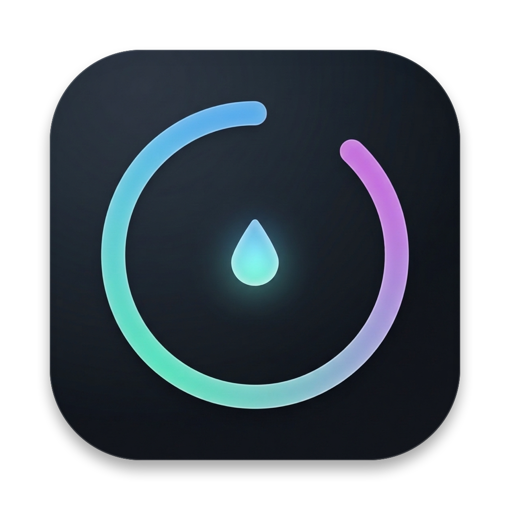

<p align="center">
  
</p>

<h1 align="center">Ren</h1>

<p align="center">
  <em>Ren</em> (Swedish: <strong>clean, pure</strong>) — a lightweight, open-source macOS cleaner built with a native <strong>SwiftUI</strong> frosted-glass interface and a high-speed parallel <strong>Rust</strong> scanning engine.
</p>

---

### Highlights

- **Ultra-Lightweight (~1.4 MB app bundle)**: Native SwiftUI + Rust (`libcleaner_core.dylib`), no Electron, no background daemons, zero telemetry.
- **Safe by Default**: Every cleanup moves files to the native macOS **Trash** (`NSFileManager`), never `rm -rf`. You can restore anything at any time.
- **Live Gradual Scan**: Watch categories and the donut chart fill in progressively as the parallel Rust scanner (`jwalk`) inspects your storage.
- **Smart & Advanced Modes**:
  - **Smart Scan**: App Caches, System Logs, Trash Bin, and Uninstalled App Leftovers.
  - **Advanced Scan**: Adds Developer Toolchains (Xcode DerivedData, CoreSimulator, Homebrew, Cargo, Yarn/npm, NuGet, Gradle), Containers & VMs (Docker Desktop, Buildx, Colima), Apple Mail Downloads & iOS Backups, and Stale Large Downloads (`.dmg`/`.pkg`/old archives).
- **Floating Desktop Widget & Menu Bar Extra**: Collapse the window into a compact always-on-top liquid-glass desktop widget or trigger scans directly from the macOS menu bar.

---

### Architecture

```text
core/                 # Rust scanning & safe-trashing engine (cdylib)
  src/
    domain.rs         # CleanCategory, CleanItem, ScanReport, TrashResult
    targets.rs        # Declarative directory scan target tables
    scanner.rs        # Parallel jwalk filesystem scanner (symlink-safe)
    trash.rs          # Native macOS Trash integration
    lib.rs            # Panic-safe C-ABI exports

app/                  # Native SwiftUI macOS application (macOS 12+)
  Sources/
    RenApp/           # @main entry point
    RenKit/           # Domain, C-ABI CleanerBridge, CleanerViewModel, AppDelegate
      Views/          # DashboardView, MiniWidgetView, LiquidGlass, CategoryComponents, FileDetailsSheet
  Tests/RenTests/     # Unit & deallocation tests

assets/               # Ren Swedish minimalist icon & macOS AppIcon.icns
build.sh              # One-command release bundler -> dist/Ren.app
```

---

### Building from Source

#### Prerequisites
- macOS 12 (Monterey) or later
- Xcode Command Line Tools / Xcode (Swift 5.7+)
- [Rust](https://rustup.rs/) (`cargo`)

#### Build & Run
```bash
./build.sh
open dist/Ren.app
```

#### Run Tests
```bash
# Rust core tests
cd core && cargo test

# Swift tests (requires release core dylib built once via ./build.sh)
cd app && swift test
```

---

### Safety & Privacy

- Runs 100% locally with zero network requests.
- Symlinks are never followed (`lstat`) during cache or leftover scans.
- All advanced targets are opt-in (unchecked by default) and every file can be reviewed in the **Inspect Files** sheet before trashing.

---

### License

MIT — see [LICENSE](LICENSE).
